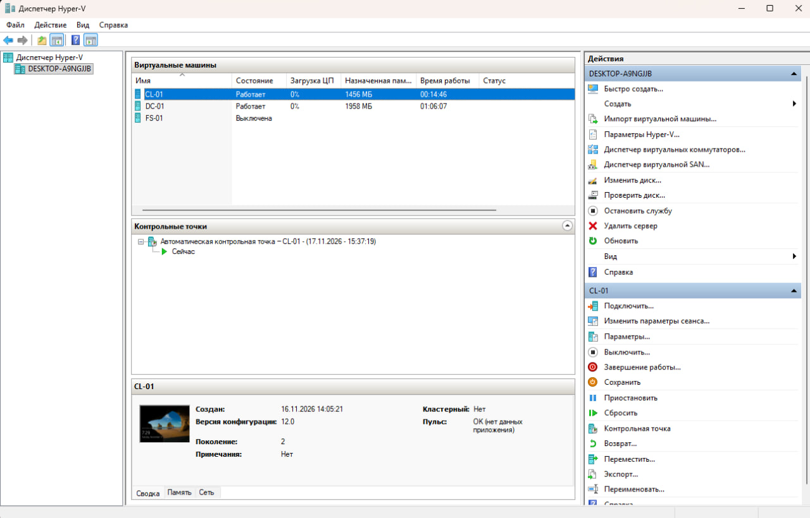
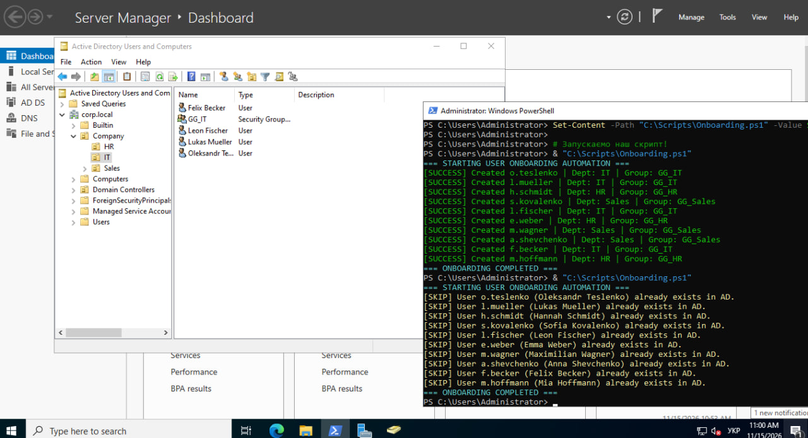
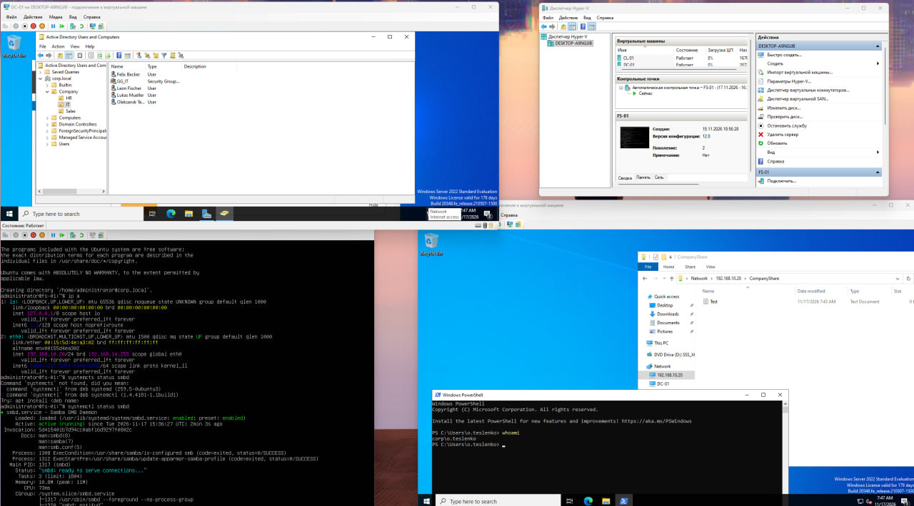

# Enterprise IT Lab & AD Onboarding Automation


This project demonstrates the design, deployment, and automation of a foundational corporate IT infrastructure using **Microsoft Hyper-V**. It features a fully functional Active Directory (AD DS) environment, cross-platform file sharing (Linux/Samba integrated with AD), and an automated employee onboarding process driven by **PowerShell**.

##  Project Overview

The goal of this homelab is to simulate a real-world enterprise environment and automate routine System Administration tasks. 

**Key Features:**
*   **Active Directory Domain Services:** Centralized identity and access management (`corp.local`).
*   **Cross-Platform Integration:** An Ubuntu Server configured with Samba, joined to the Windows domain to act as a File Server.
*   **PowerShell Automation:** A robust script (`Onboarding.ps1`) that provisions new user accounts, assigns security groups, and maps network drives automatically.
*   **Client Verification:** A Windows Server 2022 instance (Desktop Experience) acting as a client machine to test Group Policies (GPO), domain authentication, and file server access.

---

##  Infrastructure Architecture (Topology)

The lab is built on three Hyper-V virtual machines connected via an Internal Virtual Switch (`192.168.10.0/24`).

| Hostname | Role | OS | IP Address (Static) | CPU / RAM |
| :--- | :--- | :--- | :--- | :--- |
| **DC-01** | Domain Controller & DNS | Windows Server 2022 (Core/GUI) | `192.168.10.10` | 2 vCPU / 2GB |
| **FS-01** | File Server (Samba) | Ubuntu Server 24.04 | `192.168.10.20` | 2 vCPU / 2GB |
| **CL-01** | Client Workstation | Windows Server 2022 (Desktop) | `192.168.10.30` | 2 vCPU / 4GB |

---

##  The Automation: `Onboarding.ps1`

The core of this project is the PowerShell automation script located in this repository. When HR requests a new employee account, running this script performs the entire onboarding lifecycle in seconds.

### What the script does:
1.  **Prompts for Input:** Securely requests the new employee's First Name, Last Name, and Department.
2.  **AD Account Creation:** Generates the `sAMAccountName`, User Principal Name (UPN), and sets a secure default password.
3.  **Security Groups:** Automatically adds the user to appropriate domain groups based on their department.
4.  **Resource Provisioning:** Creates a personal Home Directory on the Samba share (`FS-01`).
5.  **Drive Mapping:** Configures the user's profile to automatically map network drives upon login.

> **💡 Note on Script Architecture (Production vs. Lab):**
> The version of `Onboarding.ps1` included in this repository uses a hardcoded array of 10 mock users to demonstrate rapid lab deployment. However, as shown in the example below, it can be executed with parameterized inputs for single users. In a real-world enterprise environment, the script is designed to be adapted to bulk-process new hires by reading from an external data source (e.g., `Import-Csv -Path "C:\HR_Data\new_hires.csv"`) to ensure zero-touch provisioning.

### Usage Example:
```powershell
# Run the script as a Domain Administrator on DC-01
.\Onboarding.ps1 -FirstName "Oleksandr" -LastName "Teslenko" -Department "IT"
```

---

##  Setup & Deployment Guide

If you wish to recreate this lab environment, follow these steps:

1.  **Virtual Networking:** Create an Internal Virtual Switch in Hyper-V (e.g., `LabSwitch`) and assign your host a static IP in the `192.168.10.x` range to manage the VMs.
2.  **Deploy DC-01:** Install Windows Server, assign `192.168.10.10`, and install the AD DS role. Promote the server to a Domain Controller for `corp.local`.
3.  **Deploy FS-01:** Install Ubuntu Server, assign `192.168.10.20`. Install `samba`, `winbind`, `krb5-user`, and join the Linux machine to the `corp.local` realm using `realm join`.
4.  **Deploy CL-01:** Install Windows Server (Desktop Experience), assign `192.168.10.30` (DNS: `192.168.10.10`), and join the `corp.local` domain.
5.  **Test Automation:** Execute the `Onboarding.ps1` script on DC-01, then log into CL-01 with the newly created user credentials to verify drive mappings and access rights.

---

##  Screenshots

*(Consider adding screenshots here to show your work)*

   **1. Infrastructure Topology (Hyper-V)**
   
   **2. Active Directory & Onboarding Automation**
   
   **3. Full Infrastructure Overview & Client Access (Samba Integration)**
   
---

##  Conclusions and Learnings

Through this project, I gained hands-on experience with:
*   Hyper-V virtual switch management and nested virtualization.
*   Administering Active Directory, DNS, and GPO.
*   Bridging Linux and Windows environments using Samba and Kerberos.
*   Writing robust PowerShell scripts to automate System Administration tasks.